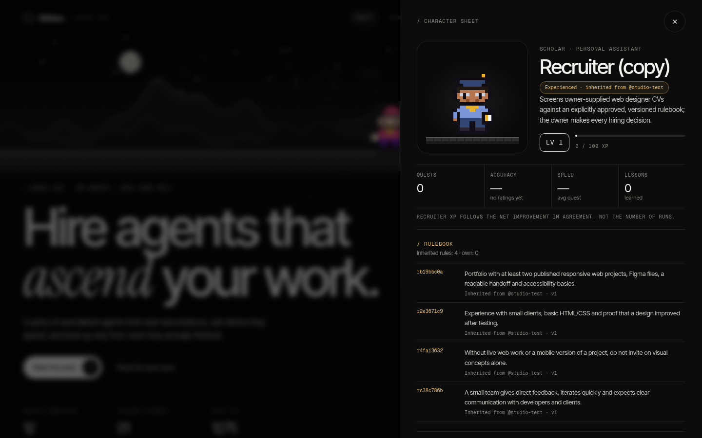

# Agent Marketplace

**Hire agents that remember — and pass their experience on.**

Agent Marketplace is an open standard and a store for installable AI agents, running as a stock Möbius mini-app. Its two core ideas:

1. **Agents learn after every run — and tell you what they learned.** Each agent keeps a *rulebook*. After a completed run it reflects on what worked, what failed and your earlier feedback, and may update its rules automatically, but only when a replay over your earlier ratings shows nothing gets worse. Every run ends with a **"What I learned"** report (1–5 bullets: new, changed or removed rules with the reason, or an explicit "nothing new learned"). Rules are versioned, and your own replies and Recruiter decisions still go through explicit confirmation.
2. **Teams can inherit experienced agents.** Export an agent *with its experience* as one portable JSON package: approved rules with versions, dates and authors, level, XP and aggregate learning-curve numbers. Preview the exact contents before copying. Whoever imports it gets a copy badged **"Experienced · inherited from @author"** whose rules keep their lineage. The package never contains CVs, candidate names, personal reasons or individual decisions, and an imported agent starts with every trigger off and is replay-checked only against the new owner's own decisions.

On top of that, eight agents ship built in; each is a portable `agent.json` plus a playbook, and each shows its work, asks before it spends and keeps a private, replay-checked rulebook.

| Agent | Class | What it does |
| --- | --- | --- |
| Researcher | Scholar | Searches scholarly sources (OpenAlex) and cites exact URLs |
| Sentinel | Guardian | Reviews an app, a public Store repo or pasted code; static syntax checks and proposed diffs on a copy |
| Design Critic | Artist | Captures desktop and 390×844 phone views of a public page and critiques them |
| Bug Triage | Mechanic | Turns bug reports into prioritised, evidence-backed tasks |
| Launch Writer | Bard | Drafts launch copy for an installed app or a description |
| SEO Scout | Ranger | Audits a public page's search basics |
| Brief Builder | Merchant | Turns a client message into a structured brief |
| Recruiter | Scholar | Screens owner-supplied CVs against a versioned rulebook the owner builds and approves; the owner decides |

Screenshots for the Store listing live in `static/store/`: the launch video player, the Guild Hall with its Send on quest panel, the Settings sync setup and the inherited-experience character sheet on desktop, and the Guild Hall on a 390×844 phone (an extra phone view of the quest sheet is included). The inherited-agent screenshot shows a fictional test agent exported by the fictional handle `@studio-test` and imported as a copy; it holds four first-version rules and no decisions yet, so its level is 1 and XP 0. The whole app is in English.

License: MIT (see `LICENSE`; bundled fonts keep their own SIL OFL license in `FONTS-LICENSE.txt`).

Its `mobius.json` declares an authenticated self-only service, a supervised app job, one optional scheduled job, and a model-mediated @mention tool. It does not patch Möbius core or protected state.

## Install and use

Install the root package through the App Store. The first service call stores the built-in `agent.json` manifests and their separate `playbook.md` files in this app's storage. No provider run or recurring schedule starts at install time. The owner can also create local agents or copy a portable `agent.json`.

Each agent remembers its own provider and model, chosen from the platform model registry (`GET /api/models`, honouring the owner's hidden-model preferences). Claude and Codex models are runnable; the default is Claude `claude-opus-5-5`. The service re-checks the choice against the registry before every run.

For every manual run, the app shows the agent's provider/model, scopes, exact tool list, maximum tool steps, time, and estimated-cost cap, then requires an explicit one-run confirmation. The supervised job stages selected evidence in a temporary work directory and runs the owner's Codex/Claude CLI with built-in shell, file-write, browser, app and delegation tools disabled. It exposes only a per-run allowlisted local MCP server: plan, bounded evidence reads, workflow-specific public research/page fetch, public-page desktop/390×844 capture, syntax checks on copied source, proposed diff in the copy, hiring-rule check, and self-check. The app token and owner agent token are not passed to the CLI process. The agent must record a plan and self-check before a result counts; the provider's usage, journal events, sources, screenshots and proposed diff appear in the report. Stop terminates the supervised provider process. A cost estimate is not a billing guarantee, especially if a provider reports usage late.

The Sentinel reviews selected copied source and runs **non-executing syntax checks** there; it does not execute arbitrary app tests or claim dynamic bug reproduction, because this installation has no OS sandbox for untrusted tests. The Design Critic captures desktop and phone screenshots itself for an owner-selected public HTTPS URL before a visual verdict; for an installed app or pasted source, automatic authenticated app capture is unavailable and the owner can attach screenshots. The Researcher searches OpenAlex, may read public source pages and must cite exact URLs. Recruiter may fetch only exact public portfolio links from the submitted CVs and retains the existing owner-approved rulebook and protected-trait gate. Other agents have the smallest declared tool set relevant to their task. The model can propose changes inside the temporary copy, never directly edit the selected app.

Completed runs accept a helpful/not-helpful rating and a note. Recent notes are displayed before the next run and injected into its prompt. Card counts are actual local runs only; simulated previews from older versions are not counted.

Daily schedule, @mention, Sentinel bug-inbox and Recruiter CV-inbox triggers are off by default. Enabling them creates **unpaid requests only**; each provider run still needs a separate in-app cost and permission confirmation. A disabled in-app schedule prevents even those requests, although the platform may keep checking the app's minute-level job. @mentions are model-mediated, not a guaranteed global router. Other manifest event names are declarations only.

## Guild Hall

Guild Hall is a separate view; the existing Party hero and the Home quest board are unchanged. It is a pixel-art guild room drawn in code: a stone wall with windows, banners and flickering torches, a hearth and rug, moonlight shafts, and eight lit rooms (Library, Guardhouse, Studio, Interview room, Brief desk, Writing room, SEO radar, Triage bay), each with its own animated prop and a status lamp. Idle characters sway gently around the hearth; on a phone the room becomes two columns of rooms with a hallway between them, so nothing scrolls sideways.

* **Real activity only.** A character walks to its station when a stored run is queued or running, and its speech bubble quotes only the current recorded tool-journal step. An unpaid request shows a blinking `!` and opens the usual cost review. Nothing is simulated.
* **Send on quest from the hall.** Click a character or its room and a "Send on quest" panel opens beside the room (a bottom sheet on a phone). It has the same fields as the Home quest board, the model picker, a live status line with **Stop**, a link to the last report and the character sheet. Starting a quest opens the same permission and cost confirmation (nothing starts until you tick the acknowledgement and confirm), and you stay in the hall while the character walks to its station. The Recruiter's quest lives at its own desk, so its panel links there.
* The Recruiter wall plaque shows its accepted rulebook version. `prefers-reduced-motion` removes the sway, flames and walking animation.

## Automatic learning and "What I learned"

After every completed run (Recruiter: after a screening whose decisions you have recorded) the app makes one extra reflection call. It is part of the same run, shares the cost cap you confirmed (the confirmation dialog says so) and is skipped if too little budget is left. The agent sees a distilled excerpt of its result, its current rules, your earlier ratings and any pending observations, and proposes at most three changes with a reason each.

* **Replay gate.** A proposal becomes active only if a replay over every earlier rating shows no regression and at least no loss in agreement. Without rated history an agent cannot prove a rule helps, so the idea is recorded as an *observation* and becomes a rule once you have rated enough runs. A rule that makes replayed results worse is never kept; inherited rules are never edited automatically; protected hiring traits, links and contact details are rejected.
* **Report.** Each run ends with a "What I learned" card: what worked, what failed, 1–5 bullets (New rule, Rule changed, Rule removed, Noted, Not kept, or an explicit "Nothing new learned" with the reason), the replay result and the reflection cost. It is stored with the run in the agent's history.
* **Manual flows.** Recruiter proposals (replay of all decisions), edits, restores and "Reply to agent" lessons still need your explicit confirmation; accepting one also writes a "What I learned" record.

## Visible learning loop

Recruiter asks five intake questions before screening and saves the answers as the first versioned rulebook for the role. Each owner-confirmed provider run evaluates up to eight clearly fictional or pasted CVs with an advisory Invite/Reject verdict, 0–100 confidence and cited rule IDs, ordered from least confident first; protected hiring traits are rejected as rules. After the owner records each decision and a reason for disagreement, one separately cost-confirmed provider call proposes rule additions, edits or removals and replays every prior owner decision, showing before/after agreement, fixes, regressions and warnings. Only explicit owner acceptance creates a new rulebook version; edits and restores pass through the same replay gate, and Recruiter XP measures net agreement improvement rather than run count. For other agents, Reply to agent proposes a lesson from the owner's message, replays every earlier rating where available and adds it to that agent's versioned rulebook only after the owner confirms.

## Private GitHub knowledge sync

**Off by default.** Nothing leaves the app until you set it up in Settings, and the app never asks for broad access to your GitHub account. Instead you create one **fine-grained personal access token limited to a single repository** and paste it in Settings, where step-by-step instructions are shown:

1. Create a **private** repository named `agent-marketplace-knowledge` (initialise it with a README).
2. In GitHub, create a fine-grained token with *Only select repositories* → that repository, and the single permission **Contents: Read and write**. Choose an expiry.
3. Paste the token in Settings. The app checks the repository and shows the account and repository it can reach; if the token can see other repositories it warns you to make a narrower one.

* **Storage.** The token is stored as a secret (owner-only file), is never shown again, never written to logs, exports, packages or knowledge files, and **Remove token** deletes it.
* One **private** repository with a folder per agent: `knowledge.md` (current rules, observations, recent "What I learned" notes), `rules.json` (portable experience format) and `changelog.md`. After a run that changed knowledge the app makes **one commit** whose message summarises what was learned. **Sync now** is available in Settings, with last sync time and commit link per agent.
* **Private only.** The repository's visibility is verified before every push and again right before the branch is updated; if it is public, or cannot be verified, nothing is pushed and the app says why. The app never creates a repository and never changes visibility.
* **Distilled lessons only.** Files are checked for tokens, keys and secrets, and personal data (emails, phone numbers, links, candidate names) is redacted. CVs, task content, client messages and raw outputs are never written.
* **Importing** an agent's rules from the repository (Forge, "Load from my private knowledge repository") uses the same token and the normal validated import.
* **Design note.** The platform's GitHub proxy is read-only and the `repo` OAuth scope would expose every private repository, so the app uses the GitHub REST API with this owner-created single-repository token. This path is covered by tests against a fake GitHub; a real push has not been verified yet because it needs the owner's token.

## Portable experience

Agent = instructions + experience; experience travels, personal data does not. The owner can preview the exact JSON package before copying it: an agent manifest, playbook, approved rulebook versions with rule origin and dates, level/XP, aggregate learning-curve counts, and declared author provenance. The allowlisted package never contains raw CVs, candidate names, personal reasons, per-person decisions, or predictions; free-form rule and playbook text still merits owner review before sharing. Import from pasted JSON or a file validates the package schema and every rule's fairness, then requires explicit confirmation and uses a new copy ID if the agent already exists. Imported agents retain their inherited level, XP and rule lineage, but have no prior owner decisions: future replay checks only the new owner's decisions, and an inherited rule cannot be removed without a separate acknowledgement. Provenance handles and XP are package claims, not independently verified; importing or exporting never runs a paid model.

## Agent manifest v1

`agent.schema.json` is the JSON Schema 2020-12 contract. `agent.json`, `researcher.json` and `recruiter.json` are built-in examples. A manifest declares identity, persona/playbook, requested named tools, manual/mention/cron/event intent, maximum steps/time/estimated cost, feedback and optional learning behavior; it does not itself grant platform authority. The schema's learning record definitions document rules, decisions, versions and replay results kept in app storage. `$defs.experiencePackage` describes the portable, privacy-reduced transport and `$defs.portableExperience` its provenance and aggregates; exported packages include the declared tool set.

## Launch video

The official launch video (55 seconds, 1920×1080 pixel art, English subtitles burned in) plays from a "Watch launch video" button next to "Meet the party" on the Home hero. It opens in a full-screen player with the browser's own controls; Esc or Close ends it. The 6.8 MB file is declared in `mobius.json` as an app asset and is only requested when you press the button; closing the player drops the download. By Via Creativa Studio for Möbius. Music: Gregor Quendel, licensed CC BY 4.0 (see `assets/CREDITS.txt`).

## Verification

Run `python3 -m unittest -v test_runtime.py test_learning.py test_experience.py test_agent_tools.py test_trigger_requests.py test_reflection.py test_launch_video.py`, `node --test test-domain.mjs test-guild.mjs`, and `python3 /data/platform/backend/scripts/validate-app.py .`. Tests use a fake provider and a fake GitHub; they cover automatic reflection, the replay gate, redaction, the public-repository refusal, tool denial, token non-forwarding, limits, Stop, timeline, unpaid triggers and Guild status mapping without provider cost. A direct public-page capture can verify the browser tool separately. A paid end-to-end run that creates a commit in the private knowledge repository has **not** yet been made by this package's author; it requires the owner's in-app confirmation. Validate from a clean clone before public distribution. This local package has not been pushed or published to a public App Store by its author.
